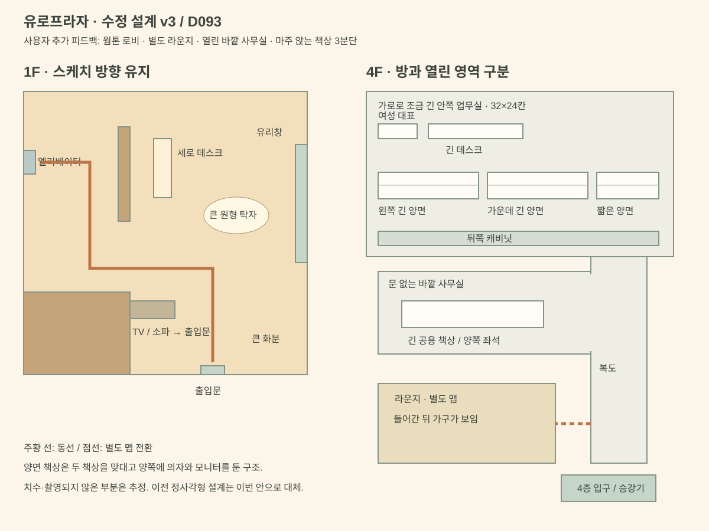

# 유로프라자 실내 재구성 · D092

2026-10-14. 사용자 촬영 영상 2개와 16:29:55의 1층 스케치를 기존 2.5D 픽셀 월드에 반영한다. 첫 추정 배치를 사용자 정정으로 대체했다. **1층은 스케치의 방향·배치가 우선이며, 4층 안쪽 업무 사무실은 정사각형이다.** 실측 치수와 촬영되지 않은 부분은 추정이다.

1층: 아래 출입문 → 왼쪽 아래 큰 벽의 오른편 TV·소파 → 중앙 위 세로 데스크 / 오른쪽 흰 원형 탁자·의자 / 오른쪽 유리창. 엘리베이터는 왼쪽 안쪽이며, 중앙 칸막이 아래를 돌아 들어간다. 상단의 문과 화장실문은 닫힌 외관만 표현한다. 4층은 긴 복도와 그 끝의 정사각형 사무실을 구분한다(업무실 24×24칸). 기존 첫 추정의 오른쪽 엘리베이터와 가로로 긴 업무실은 폐기했다.

## 자료와 관찰

원본은 사용자의 Downloads에 보관하며 저장소·공개 사이트에 복사하지 않는다. 로컬 참고 프레임은 artifacts/euro-reference/에 1초 간격으로 추출했다. 인물·모니터의 문서·연락처·상표는 게임 그림에 옮기지 않는다.

| 자료/시각 | 직접 확인한 내용 | 재구성 |
|---|---|---|
| 1층 영상 00–06초 | 석재 출입구, 금속 프레임 유리문, 진입 턱 | 거리와 연결되는 유리 정문 |
| 07–10초 | 흰 원형 테이블, 회색 안락의자, 큰 식물, 벽 TV, 노출 천장, 안내 데스크 | 왼쪽 TV/소파, 앞 데스크, 원형 테이블과 좌석; 설명으로 관계 보완 |
| 11–18초 | 낮아지는 천장 아래 밝은 통로, 기둥을 돌아 금속 엘리베이터 | 스케치에 따라 중앙 벽 아래를 돌아가는 왼쪽 통로와 승강기 |
| 4층 영상 00–26초 | 회색 금속 승강기, 세로 잔무늬, 거울, 손잡이, 버튼 패널, 밝은 바닥 | 1층/4층 승강기 안, 층 선택 후 해당 층 문으로 나가기 |
| 28–35초 | 계단 난간, 유리 출입구, 왼쪽 닫힌 반투명 유리문과 주황 띠, 석재 벽, 흰 원형 탁자/회색 의자 | 4층 도착 영역, 닫힌 왼쪽 문, 출입구와 대기 자리 |
| 36–46초 | 라운지 유리 경계, 검은 작은 테이블/의자, 긴 목재 테이블/높은 의자, 창과 블라인드, 구형 펜던트, 노출 배관/스폿등, 회색 수납/작업대 | 복도로 가기 전 들를 수 있는 라운지; 목재·회색·검은 프레임 |
| 47–53초 | 직선 복도, 왼쪽 개방형 사무실과 흰 수납장, 오른쪽 노란 벽감/유리문, 소화기, 벽면 잡지 선반 | 왼쪽 바깥 사무실 출입, 안쪽까지 이어지는 복도; 오른쪽 방은 닫힘 |
| 54–64초 | 안쪽 개방형 사무실, 흰 책상/모니터/회색 사무 의자 반복, 벽쪽 흰 수납, 긴 창과 흰 블라인드 | 주인공 업무 공간(newsroom), 기존 취재·기사 기능 유지 |

## 설계도

위쪽은 실제 북쪽이 아니라 **진행 방향**이다. 카메라가 회전하므로 화면의 왼쪽을 곧바로 건물의 서쪽으로 취급하지 않는다. 4층 입구 → 라운지 곁 → 직선 복도 → 왼쪽 바깥 사무실 → 더 안쪽 업무 공간 순서를 유지한다. 방을 오갈 때 도착점은 문 밖 안전 지점이며 왕복이 가능하다.

**추정:** 실측 길이（안쪽 업무실의 정사각형 형태는 사용자 확정）, 기둥 뒤의 벽 연결, 라운지 외곽과 복도 사이 정확한 각도, 책상 총수, 촬영하지 않은 자리 배치. 라운지를 복도 왼쪽에 두는 것은 35–40초의 유리문 회전과 이후 직진을 맞춘 작업 가설이다. 1층의 방향과 가구 관계는 최신 스케치를 우선한다. 화면 가독성 때문에 거리를 압축하며 천장을 제거한 단면으로 표시한다.

**게임용 배치:** 편집장·주인공 책상·바디스코프는 기존 퀘스트를 위한 장치다. 실제 촬영 속 특정 인물/책상의 신원이나 실제 기기의 존재를 주장하지 않는다. 2/3층은 만들지 않으며, 닫힌 방·계단 뒤 공간을 임의의 방문 가능한 사무실로 확장하지 않는다.

## 구현 순서와 확인

1. 타임코드 관찰 장부와 평면 동선.
2. 1층 및 승강기, 층 표기를 4층으로 정정.
3. 입구·라운지·복도·바깥 사무실·안쪽 편집국을 왕복 연결.
4. 재질/가구와 출입구 충돌, 저장 호환, 기존 기사 루프 검증.

사용자 눈으로 영상과 배치를 대조하는 단계는 남아 있다. 자동 검사 통과를 실제 공간과 완전히 같다는 증거로 쓰지 않는다. 실측 치수·영상 밖 벽·실제 휴대폰/Safari도 미확인이다.

## D093 · 사용자 수정안 (2026-10-15, D092 일부 대체)

- **1층:** 웜톤 바닥·벽과 주황색 고정 조명, 큰 원형 탁자(그림 너비 76px), 큰 화분(높이 68px). 소파는 아래 출입문을 향한다. 확대된 가구의 바닥 충돌과 좌석 사이 이동 공간도 함께 조정한다.
- **라운지:** `lounge` 별도 맵. 복도에는 문턱만 그리며, 가구는 실제 들어갔을 때만 렌더링한다.
- **바깥 사무실:** 복도와 같은 `floor4` 맵이며 문·페이드·전환이 없다. 긴 양면 공용 책상 하나에 여러 좌석이 붙고 양쪽이 서로 마주 본다.
- **안쪽 업무실:** 32×24칸의 가로 직사각형. 왼쪽 위 여성 대표 자리, 그 오른쪽 긴 데스크. 그 아래 업무 구역은 왼쪽·가운데 긴 양면 책상과 오른쪽 짧은 양면 책상의 3분단이다. 각 분단은 중앙을 맞댄 두 책상과 양쪽 모니터·의자로 구성한다. 캐비닛은 맨 뒤(미리보기 아래쪽), 위쪽 책장·화분은 없다. 기존 자료 열람은 뒤쪽 캐비닛에서 한다.
- **저장 이행:** 과거 `outeroffice`는 열린 사무실로, 복도 맵에 있던 라운지의 저장 위치는 새 라운지로 옮긴다. D092에 유효했던 위치가 새 가구 아래로 들어간 경우에만 해당 방의 안전 지점으로 이행한다. 임의의 잘못된 위치는 계속 거부한다.

3분단의 좌우 길이와 캐비닛의 뒤쪽 방향은 현재 요청을 평면으로 옮긴 배치다. 이번 미리보기로 사용자 확인을 받으며 실제 책상 수·실측 치수는 주장하지 않는다. 이전 절의 정사각형 업무실·독립 바깥 사무실·공개 라운지 설명은 D092 당시 기록이다.

## D094 · 로비/엘리베이터 통로 분리, 4층 열린 사무실 확장과 유리 회의실 (2026-10-15)

사용자 지시(2026-10-15 09:18)가 영상 추정보다 우선한다. 승인된 1층 로비(웜톤·주황 조명, 큰 흰 원형 탁자와 화분, 출입문을 향한 소파)와 라운지(별도 맵), 안쪽 사무실(32×24칸, 왼쪽 위 대표 자리·긴 데스크·3분단·뒤쪽 캐비닛)은 그대로 둔다.

- **1층 엘리베이터 통로(`lifthall`, 12×12칸):** 로비 왼쪽 안쪽(데스크 뒤 칸막이를 돌아간 자리)의 뒷벽 개구부로 들어가는 별도 맵. 들어서면 아래쪽에서 위를 보고 서며, 뒷벽 한가운데에 금속 엘리베이터 문(문틀 76px, 두 짝 문과 가운데 이음매, 위 층 표시 ‘1’과 오르내림 화살표, 오른쪽 호출 버튼, 왼쪽 ‘1F’ 판, 바닥 문턱)이 정면으로 크게 보인다. 낮아진 천장과 따뜻한 조명은 벽 위 띠·바닥의 빛 웅덩이로 표현했다. 방 전체가 192×192px라 휴대폰 세로·가로(배율 2)에서도 들어서는 순간 문이 화면 안에 있다. 문 앞을 밟으면 승강기 안(`lift1`)으로, 승강기에서 나오면 문 앞 통로에 아래를 보고 선다. 로비 옆벽의 작은 승강기 표현은 없앴다.
- **4층(`floor4`, 30×33칸, 한 맵):** 아래 승강기 → 입구(왼쪽 벽의 닫힌 반투명 유리문·주황 띠) → 오른쪽 세로 복도 → 끝의 유리문이 안쪽 사무실. 라운지 문은 복도 오른쪽 벽(입구 바로 위)에 있고 들어가야 라운지 맵이 보인다. 복도 왼쪽 전체가 문 없이 이어지는 바깥 사무실이다.
  - 공용 양면 책상 두 분단(`longbench`, 각 200px): 분단마다 위쪽 6석·아래쪽 6석이 같은 x에서 서로 마주 본다(12석×2). 회의실 유리 앞 통로, 두 분단 사이, 뒤 분단 뒤, 책상 양 끝으로 걸어 다닐 수 있다. 흰 수납장 두 개는 뒤 분단 오른쪽 벽 쪽.
  - 왼쪽 벽: 블라인드가 내려진 긴 창 줄.
  - 뒤쪽 벽: 반투명 유리로 둘러싼 회의실 두 개(각 10칸 폭). 둘 사이는 반투명 유리 칸막이, 앞면 유리에 각각 2칸 출입구. 앞면 유리는 사람과 같은 깊이 정렬로 그려져(`interior.glass`) 안쪽 책상·의자가 유리 너머로 흐리게 보이고, 유리 앞에 선 사람은 유리 앞에 보인다. 회의실마다 가로로 긴 흰 책상, 주황·초록이 번갈아 놓인 의자 8개(위 4·아래 4), 왼쪽 벽의 큰 모니터, 뒷벽 화이트보드.
  - 충돌: 벽·유리·칸막이는 막힌 칸, 출입구만 열림, 책상·회의 탁자·모니터·수납장은 바닥 충돌. 그림과 같은 칸 기준.
- **라운지:** 맵·가구 그대로, 출입구만 왼쪽 벽으로 옮겼다(복도 오른쪽에서 들어가므로).
- **저장 이행:** `lifthall` 저장을 그대로 복원한다. D093 배치에서 유효했지만 지금 벽/가구가 된 위치(옛 복도·옛 로비 옆 승강기 자리·옛 라운지 오른쪽 출입구 등)는 D093 원래 지도(`roomsD093`)로 확인한 경우에만 그 방 안전 지점으로 옮긴다. 새 바깥 사무실 자리에 저장된 위치를 옛 라운지로 오인하지 않도록, 옛 D092 라운지 이행은 지금 설 수 없는 위치에만 적용한다. 그 밖의 잘못된 위치는 계속 거부한다.

**근거와 한계(정직하게 구분):** 이번 작업자는 이 환경에서 이미지 파일을 직접 볼 수 없어 166장 프레임을 눈으로 다시 분석하지 못했다. 영상 관련 배치는 위 D092 관찰 장부(타임코드)와 사용자 지시·스케치 전사에 근거했고, 4층 왼쪽 창·뒤쪽 회의실·12석 분단·회의실 가구와 색은 사용자 지시 그대로다. 회의실 크기·책상 길이·유리 높이·통로 폭·창 간격은 게임 가독성을 위한 추정이다. 프레임과의 대조는 사용자 확인이 필요하다.

## D095 · 미리보기 피드백 반영 (2026-10-15 10:04)

- **1층 로비:** 왼쪽 끝 한 칸(16px)을 줄여 24→23칸. 비어 있던 왼쪽 안쪽 공간이 좁아졌고, 통로 개구부·칸막이·데스크·TV/소파·원형 탁자·화분·정문의 상대 배치는 그대로 한 칸씩 옮겼다.
- **4층 바깥 사무실:** 12석 양면 책상 두 분단을 복도 쪽(가운데 x 232)으로 옮겼다. 비워진 왼쪽에 창을 바라보는 2인용 창가 책상 2대(`windowdesk`, 의자 `sidechair` 4개, 의자가 왼쪽 창을 향함). 창가 의자 뒤와 분단 사이로 걸을 수 있다.
- **회의실:** 큰 모니터를 각 방 왼쪽 벽에 틈 없이 붙였고(`sidescreen`), 긴 책상의 끝을 그 벽(모니터 바로 앞)에 붙였다. 의자 8개(주황·초록)는 책상 양쪽, 출입구 쪽(오른쪽)으로 드나드는 통로를 남겼다.
- **라운지(24×16칸 → 24×18칸, 별도 맵 유지):** 식탁을 2배 이상(92→192px, `bigtable`), 높은 의자 6→12개. 앞쪽 탁상을 더 길고 깊게(240×34px, `counterbar`). 뒤쪽 싱크대와 화분 삭제. 왼쪽 벽(문 위쪽)에 1열 긴 책상(`walldesk`)과 의자 3개. 큰 소파 2개(`bigsofa`)를 문 가까이 벽에 붙였다: 하나는 문 아래 왼쪽 벽, 하나는 아래 벽. 더 큰 낮은 탁자(`loungetable`)는 소파 옆(뒤가 아님).
- **안쪽 사무실(32×24 → 32×28칸):** 3행. 맨 위: 왼쪽 끝 대표 자리(새 인물 `ceo` ‘대표’, 짧은 인사 대사), 가운데 편집장이 혼자 쓰는 긴 책상(퀘스트 담당 `editor` ‘편집장’, 기존 얼굴), 맨 오른쪽 끝 바디스코프. 그 아래에 기존 책상 줄(왼쪽·가운데 양면 책상 + 오른쪽 짧은 양면 책상)을 복사해 두 줄. 내 자리는 첫 책상 줄 왼쪽 위 자리, 선배 기자는 그 옆. 캐비닛은 맨 뒤. 바디스코프에서 돌아오면 바디스코프 앞에 선다.
- **해석한 부분(사용자 확인 필요):** ‘왼쪽 끝 1블럭’은 로비 맨 왼쪽 한 칸으로, 회의실 ‘책상도 벽쪽에 붙어’는 모니터가 있는 왼쪽 벽에 책상 끝을 붙이는 것으로, 대표와 편집장은 서로 다른 두 사람으로(대표=새 인물, 편집장=기존 퀘스트 인물) 해석했다.
- **저장:** D094 미리보기 지도도 `roomsD094`로 보관해, 그때 유효했던 위치가 새 벽·가구가 되면 그 방 안전 지점으로 옮긴다.

